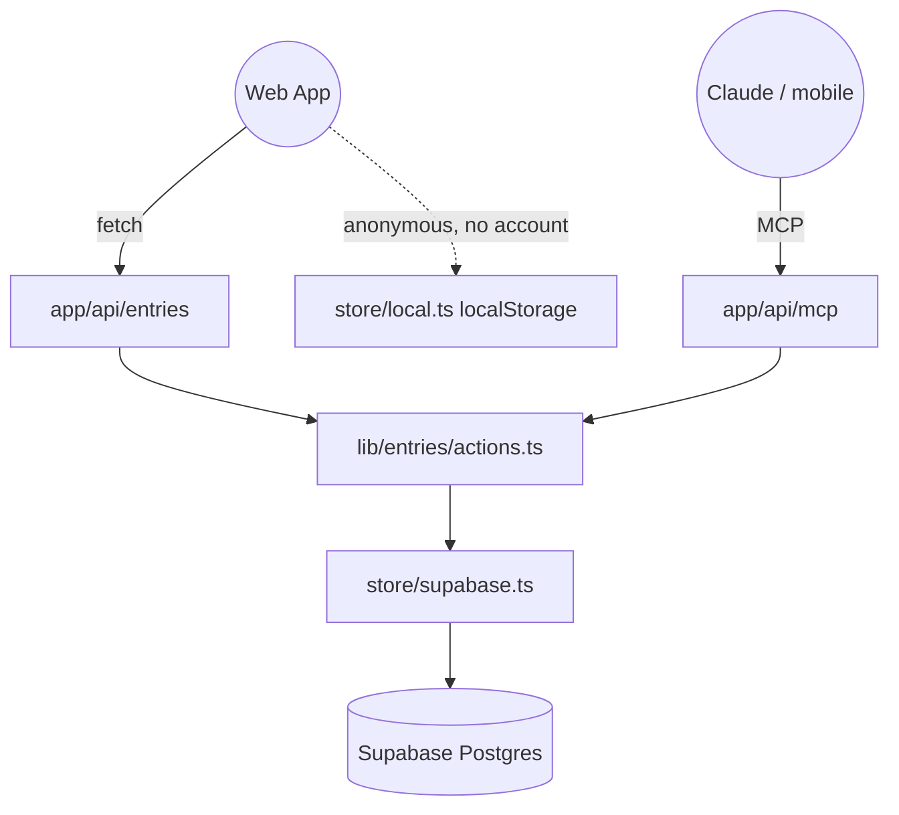

# 🧠 Thought Record — Specification Document

## 1. Overview

**Thought Record** is a personal CBT thought-record journal. It is the digital replacement for a therapy homework assignment: writing down a situation, the thoughts it triggered, the feelings that came with them, and the evidence for and against those thoughts.

It is built around two front ends over one shared core:

- A **web app** for writing and reviewing entries.
- An **MCP server** so entries can be written and reviewed conversationally from Claude (including Claude mobile), where the model doing the reasoning is the user's own Claude — not a model this project pays for.

The project is personal. Sign-up is open and anyone may use the public instance, but it is built for one user's needs and carries no support promise.

### 1.1 Design Principles

These constrain every feature decision in this document.

- **The tool must never be the reason an entry doesn't get written.** Capture is the bottleneck in paper thought records. Anything that slows down writing loses to a notes app.
- **An entry does not have to be finished in one sitting.** Testing a thought requires a calmer head than having it does. Entries can be saved incomplete and finished later. This is not a degraded state — it is the normal path.
- **The AI asks, it never concludes.** It may ask the Socratic questions from the worksheet ("what supports this thought? what contradicts it? what would you tell a friend who thought this?"). It must not decide whether a thought is true. The skill being built belongs to the user, and an AI that supplies conclusions prevents it from forming.
- **This is therapy material.** No analytics on entry content, no public demo mode seeded with real data, no logging of entry bodies. Every read path is scoped to one user.

### 1.2 The Four Columns

The standard CBT thought record (Greenberger & Padesky) has seven columns. The user's psychologist assigned a simplified four-column version after the first session. The UI shows four; the database stores all seven from day one, so raising the UI to seven later needs no migration and no backfilling of entries whose moment has passed.

| # | Column | In v1 UI | Field |
|---|---|---|---|
| 1 | Situation | yes | `situation` |
| 2 | Automatic thoughts | yes | `thoughts` |
| 3 | Feelings (+ intensity each) | yes | `feelings` (`[{name, intensity, valence?}]`) |
| 4 | Evidence for the thought | no, retired | `evidence_for` |
| 5 | Evidence against the thought | no | `evidence_against` |
| 6 | Balanced / alternative thought | yes | `balanced_thought` |
| 7 | Feelings re-rated | yes | `feelings[].intensity_after` |

Column 4 was first assigned as "is the thought consistent with reality", a merge of the standard columns 4 and 5, collected as a single `evidence_for` field. After the second session the psychologist replaced it with the alternative thought (column 6) and a re-rating of each feeling (column 7). `evidence_for` is no longer shown or asked for; the column and old values stay, and an edit leaves them untouched. Column 7 is stored per feeling as an optional `intensity_after` inside the `feelings` jsonb, not in the single-feeling `feeling_after` / `intensity_after` columns, which go unused.

## 2. Core Features

### 2.1 Entry Capture (v1)

- Four-column form: situation, thoughts, feelings, alternative thought, then each feeling re-rated.
- **Free-text feelings.** No fixed emotion list and no normalisation column. Grouping "kesel" / "sebel" / "dongkol" is done at read time by Claude over the MCP path, not at write time by the user.
- **One intensity rating per feeling, 0–100.** A situation can bring several feelings at different strengths, so `feelings` is a list of `{name, intensity}`, up to 5. The intensity is its own integer, not embedded in the name. 0–100 rather than 0–10 to match the scale used in the standard worksheet. The list shows the strongest feeling's intensity; the plot shows every feeling as its own dot.
- **Optional valence per feeling.** `good` or `bad`, set only by the user (never inferred from the name), absent when not said. It lives inside the `feelings` jsonb, so it needs no migration, and the plot encodes it by shape, not colour.
- **Split timestamps.** `occurred_at` is when the situation happened; `created_at` is when the entry was written. Entries are frequently written hours later, and ordering by write time would misrepresent the record.
- **Draft or done.** An entry saved without an alternative thought (`balanced_thought`) is a `draft`. Re-rating the feelings is optional and does not affect status. Drafts are listed separately so they can be finished later.

### 2.2 Review (v1)

- Chronological list of entries, newest first.
- Open an entry as a leaf of a book and turn to the newer or older one.
- Edit and delete any entry.
- Finish a draft: reopen it and fill in what was left blank.

### 2.3 Anonymous Mode (v1)

- The app is usable without an account; entries are stored in browser `localStorage`.
- **Deliberately web-only.** An MCP server runs server-side and has no access to browser storage, so anonymous data can never reach Claude. This is expected and accepted, not a limitation to work around.
- Intended for someone trying the app out. The primary user is always signed in.
- On sign-up, local entries are offered for import into the account.

### 2.4 MCP Server (v2)

Exposes the same actions the web app uses, as MCP tools:

- `add_entry` — create an entry from a conversation, complete or draft.
- `list_entries` — recent entries, filterable by status and date range.
- `get_drafts` — entries missing column 4, so Claude can offer to finish them.
- `update_entry` — fill in or correct fields on an existing entry.
- `delete_entry`.

No model is configured on this path and no system prompt ships with it. The tools are the whole surface; the reasoning belongs to whichever Claude the user is talking to.

**Authentication** is OAuth 2.1 with Supabase Auth as the authorization server, so the route works as a Claude custom connector (desktop and mobile). Claude registers itself dynamically, the user approves on `/oauth/consent`, and Claude sends the resulting Supabase access token as a bearer token. The route builds a Supabase client with that token, so RLS scopes every call to the user and no service-role key is involved. `/.well-known/oauth-protected-resource` points clients at Supabase; an unauthenticated request gets a 401 with `WWW-Authenticate` pointing there.

### 2.5 Psychologist Dashboard (v3)

A clean, self-contained read view built for showing to the psychologist at a session — not the raw database, and not the writing UI.

Served over a revocable read-only share link at `/s/[token]`, opened without an account.

- **A link shares a date range** (`range_from`, optional `range_to`) and is **live**: entries written later inside the range appear too. Every entry in the range is shared, including drafts; the viewer simply sees no alternative-thought section for those.
- **Links expire** (1, 7 or 30 days from the UI) and can be **revoked**, which deletes the row so the link stops opening at once. An unknown, expired and revoked link look identical to the viewer.
- **Only a sha256 hash of the token is stored**, so the token is shown once at creation and cannot be recovered. A lost link is revoked and replaced.
- **No service-role key.** The viewer has no `auth.uid()`, so the one read path is the `security definer` function `get_shared_entries(token_hash)`. It validates the token and returns that owner's entries in range, with `user_id` stripped. `share_links` itself is owner-only under RLS.
- The page sends `noindex`, `Referrer-Policy: no-referrer` and `no-store`, reads no session, and logs nothing about what was read. There is no view analytics.
- Owners manage links at `/share`, reached from the account menu. Signed-in only: anonymous entries live in the browser and cannot be shared.

### 2.6 Explicitly Out of Scope

Carried over as decisions, not oversights:

- **No Telegram bot.** The MCP path covers mobile capture.
- **No demo mode.** A feature whose purpose is letting strangers try the app is the wrong feature for a codebase holding therapy notes.
- **No per-tool rate limiting.** Every operation is a database read or write; there is no paid third-party API behind any of them.
- **No AI persona.** Any prompt written for this project starts from scratch. Nothing is adapted from the sibling `places-to-go` project, whose assistant is a roast master.
- **No streaks or gamification.** Missing a day should not generate guilt about therapy homework.

## 3. Tech Stack

### Frontend
- **Framework**: Next.js 16 (App Router)
- **Styling**: Tailwind CSS 4
- **UI Components**: Shadcn UI, Sonner
- **Data fetching**: TanStack Query

### Backend
- **Runtime**: Next.js Route Handlers
- **Database & Auth**: Supabase (Postgres + Auth, Row Level Security)
- **Validation**: Zod 4 — one schema per action, shared by HTTP routes and MCP tools
- **MCP**: `@modelcontextprotocol/sdk` (v2)

### Deployment
- **Hosting**: Vercel

### Lineage

Two existing projects are the reference, and neither is copied wholesale:

- `places-to-go` (Next + Vercel) — source of the MCP route shape and the single-registry pattern where one zod-schema'd tool definition serves several front ends.
- `money-tracker` (Astro + Netlify + Supabase) — source of the Supabase auth pattern. The Astro cookie API differs from Next's, so this is a pattern reference, not a code lift.

## 4. Architecture

The spine is a **shared action layer**. Entry operations are defined once, with zod schemas, outside any route handler. The web API and the MCP tools are both thin wrappers over it. When the MCP server is built in v2, the work is wrapping — not reimplementing logic that already lives in an API route.



Only the **client-side** storage has two implementations. Anonymous mode never reaches the server, so the server core stays Supabase-only rather than being made storage-agnostic — a thin client interface picks between calling the API and writing to `localStorage`.

## 5. Data Model

```sql
create table entries (
  id                uuid primary key default gen_random_uuid(),
  user_id           uuid not null references auth.users on delete cascade,

  occurred_at       timestamptz not null,  -- when the situation happened
  created_at        timestamptz not null default now(),
  updated_at        timestamptz not null default now(),

  -- columns 1-4, shown in v1
  situation         text not null,
  thoughts          text not null,
  feelings          jsonb not null,        -- [{name, intensity 0-100}], 1 to 5
  evidence_for      text,                  -- retired from the UI

  -- columns 5-7, stored from day one, surfaced later
  evidence_against  text,
  balanced_thought  text,
  feeling_after     text,
  intensity_after   int  check (intensity_after between 0 and 100),

  status            text not null default 'draft' check (status in ('draft','done'))
);
```

RLS: every policy on `entries` is scoped to `auth.uid() = user_id`. There is no service-role read of entry bodies, and no policy that lets anyone else read them directly.

The sole exception is `get_shared_entries(token_hash)` (v3), a `security definer` function that returns entries only to a holder of a valid, unexpired share token:

```sql
create table share_links (
  id          uuid primary key default gen_random_uuid(),
  user_id     uuid not null references auth.users on delete cascade,
  token_hash  text not null unique,   -- sha256 of the token; the token is never stored
  range_from  timestamptz not null,
  range_to    timestamptz,            -- null = open-ended
  expires_at  timestamptz not null,
  created_at  timestamptz not null default now()
);
```

Owner-only RLS (select, insert, delete). Revoking is deleting the row.

## 6. Directory Structure

```
lib/entries/
  schema.ts        zod: CreateEntry, UpdateEntry, ListEntries
  actions.ts       createEntry(userId, input), listEntries(userId, filter), ...
  store/
    supabase.ts    server-side; the only module that touches the database
    local.ts       client-side localStorage, anonymous mode
lib/share/         share links (v3): schema.ts, actions.ts, store/supabase.ts, client.ts
lib/supabase/      client and server Supabase factories, plus a session-less anon client for shared pages
app/api/entries/   thin route handlers over actions
app/api/share/     create, list and revoke share links
app/s/[token]/     the public read-only view
app/api/mcp/       MCP tool wrappers over the same actions (v2)
app/(app)/         the writing and review UI
app/(auth)/        login, register, password reset
```

## 7. Configuration

- `NEXT_PUBLIC_SUPABASE_URL` — Supabase project URL.
- `NEXT_PUBLIC_SUPABASE_ANON_KEY` — Supabase anon key, used by the browser client under RLS.
- `CRON_SECRET` — Vercel sends it as a bearer token to `/api/cron/ping`, a daily no-op query that keeps the Supabase free-tier project from pausing.

## 8. Roadmap

- [ ] **v1 — Web app**: auth, four-column form with intensity, draft/done, chronological list, edit, delete, anonymous localStorage mode.
- [ ] **v2 — MCP server**: OAuth via Supabase Auth, consent page, tool wrappers over the action layer.
- [ ] **v3 — Psychologist dashboard**: read-only view, revocable share link, printable.
- [ ] **v4 — Seven columns**: surface columns 5–7 in the UI when the psychologist raises the exercise.
- [ ] **Import on sign-up**: migrate anonymous localStorage entries into a new account.

## 9. UI & Design Guidelines

### 9.1 The World

The app is a handwritten exercise book (*buku tulis*) lying on a desk. Each entry is a leaf, written in the user's own hand and read back the same way. The whole interface is neutral grey with **one orange**; the book is the identity, so nothing else competes with the writing.

- **The desk** is the dark strip above and below a page: back links, the date, save, the pager. Its text is always light.
- **The page** is pale grey paper (dark grey at night) with a double margin rule down the left, a shadow where it meets the spine, and two more leaves showing at the right and bottom edge.
- **Ruled lines exist only where something is written.** Answers sit on a 36px rule; the page itself is plain paper with the margin lines. Entries are separated by hairlines, never cards.
- **Orange** is the only colour: primary action, focus, selection, errors, and the intensity marker.

### 9.2 Palette

Neutral greys with no hue cast. Tokens live in `app/globals.css`; both themes are specified and neither is an inversion of the other.

| Token | Light | Dark |
|---|---|---|
| `desk` | `#262626` | `#080808` |
| `paper` (page) | `#F1F1EF` | `#1C1C1C` |
| `surface` (popovers, inputs) | `#FAFAF8` | `#262626` |
| `ink` | `#151515` | `#ECECEC` |
| `ink-muted` | `#595959` | `#A4A4A4` |
| `rule` | `#C9C9C6` | `#343434` |
| `edge` (control outlines, about 3:1) | `#7A7A77` | `#787878` |
| `margin` | `#A2A29F` | `#565656` |
| `chrome` / `chrome-muted` (text on the desk) | `#ECECEA` / `#B6B6B3` | `#E6E6E4` / `#A8A8A6` |
| `signal` (orange) | `#C73E08` | `#FF6B2C` |

Intensity is a marker swipe whose length is the value, tinted from pale to full orange as it gets stronger. The tint only reinforces the length and the circled number.

### 9.3 Typography

Two hands, both handwriting.

- **Nanum Pen Script** (self-hosted Latin subset in `app/fonts/`): everything the user writes, the date, the circled numerals and the wordmark. It is thin, so it is always set large (26–40px) on a 36px line.
- **Patrick Hand**: prompts, buttons, labels and chrome, 16–19px. A plainer marker hand that stays legible small.

### 9.4 Layout and Components

Single column, mobile-first, `max-w-xl`.

- **Detail page is a book.** One leaf at a time, with older and newer entries one page away. Buttons, the left and right arrow keys and a horizontal swipe all turn the page. The position is kept in the URL with `replaceState`, so Back returns to the list rather than stepping through each page.
- **The page turn** (`components/book-reader.tsx`): the leaf is a chain of 30 vertical strips, each rotated a little relative to its parent, so the sheet bends as it lifts. Strips darken with the angle they face, a shadow follows the free edge across the page beneath, and the back of the leaf is bare paper with the page's ghost showing through. With `prefers-reduced-motion` there is no animation: the page simply changes.
- **No bordered textareas.** Each answer is a question in the marker hand with the writing directly beneath on ruled lines; the rules are the field, and it grows in whole lines. Focus shows an orange outline.
- **Buttons are hand-drawn**: corners that never quite match. Primary is filled orange; secondary is a pen outline; quiet actions are plain text.
- **The intensity slider starts empty**, shows a dash until touched, and snaps in steps of 5. It draws the same marker swipe the record reads back.
- **Drafts** are marked with muted text (`belum diuji`), never a badge. **No empty state screen**: with no entries the app opens into the composer.
- **List rows lead with date and feelings, then intensity, then the thought.**

### 9.5 Voice

UI copy is Indonesian, lower case, conversational, no exclamation marks. The prompts sound like the psychologist (`apa yang terjadi?`). Nothing congratulates the user or remarks on how long it has been.

### 9.6 Motion

The page turn is the one authored moment, plus a small settle when a draft's alternative thought is filled in later. Everything else is still. `prefers-reduced-motion` is respected.

### 9.7 Quality Floor

- Intensity is never colour alone: the swipe is a length and the number is always present.
- Contrast meets WCAG AA in both themes. The orange against the charcoal desk does not hold by day, so desk controls take a chalk focus ring and the filled save button carries white text.
- Visible keyboard focus on every interactive element.
- Entry text is 26px or larger, well above the 16px iOS zoom threshold.
- Both themes are fully specified.

# This is NOT the Next.js you know

This version has breaking changes — APIs, conventions, and file structure may all differ from your training data. Read the relevant guide in `node_modules/next/dist/docs/` (resolved from this file's directory; in monorepos the `next` package may not be visible from the repo root) before writing any code. Heed deprecation notices.

This block is written and re-added by `next dev` — verify at `node_modules/next/dist/server/lib/generate-agent-files.js`. Removing it from a diff only re-creates the uncommitted change; committing it with your work keeps the tree clean.

<!-- END:nextjs-agent-rules -->
